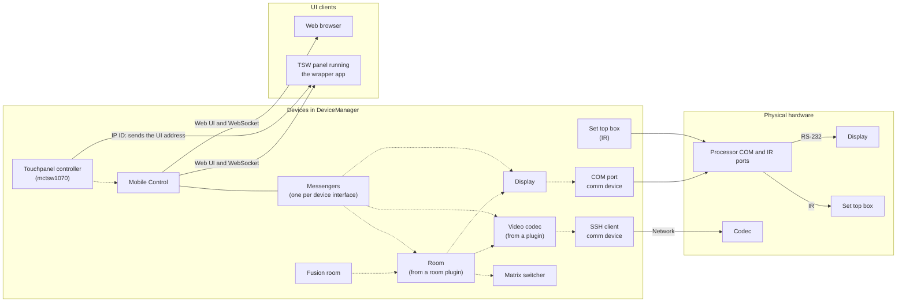

# Essentials architecture

## Device and DeviceManager

---
[YouTube Video - The Device Model in PepperDash Essentials](https://youtu.be/QF4vCQfOYGw)
***

A `Device` (`PepperDash.Core.Device`) is a logical construct. It may represent a piece of hardware, a port, a socket, a collection of other devices/ports/constructs that define an operation, or any unit of logic that should be created at startup and exist independent of other devices.

`DeviceManager` (`PepperDash.Essentials.Core.DeviceManager`) is the collection of all Devices. The collection of everything we control, and other business logic in a system. See the list below for what is typical in the device manager.

## Flat system design

In Essentials, most everything we do is focused in one layer: The Devices layer. This layer interacts with the physical Crestron and other hardware and logical constructs underneath, and is designed so that we rarely act directly on the often-inconsistent hardware layer. The `DeviceManager` is responsible for containing all of the devices in this layer.

Types of things in `DeviceManager`:

* Rooms
* Sources
* Codecs, DSPs, displays, routing hardware
* IR Ports, Com ports, SSh Clients, ...
* Occupancy sensors and relay-driven devices
* Logical devices that manage multiple devices and other business, like shade or lighting scene controllers
* Fusion connectors to rooms

A Device doesn't always represent a physical piece of hardware, but rather a logical construct that "does something" and is used by one or more other devices in the running program.  For example, we create a room device, and its corresponding Fusion device, and that room has a Cisco codec device, with an attached SSh client device. All of these lie in a flat collection in the `DeviceManager`.

> The `DeviceManager` is nothing more than a modified collection of things, and technically those things don't have to be Devices, but must at least implement the `IKeyed` (`PepperDash.Core.IKeyed`) interface (simply so items can be looked up by their key.) Items in the `DeviceManager` that are Devices are run through additional steps of [activation](~/docs/technical-docs/Arch-activate.md#2-pre-activation) at startup.  This collection of devices is all interrelated by their string keys.

In this flat design, we spin up devices, and then introduce them to their "coworkers and bosses" - the other devices and logical units that they will interact with - and get them all operating together to form a running unit. For example: A room configuration will contain a "VideoCodecKey" property and a "DefaultDisplayKey" property. The `DeviceManager` provides the room with the codec or displays having the appropriate keys. What the room does with those is dependent on its coding.

> In the default Essentials routing scheme, the routing system gets the various devices involved in given route from `DeviceManager`, as they are discovered along the defined tie-lines. This is all done at route-time, on the fly, using only device and port keys. As soon as the routing operation is done, the whole process is released from memory. This is extremely-loose coupling between objects.

This flat structure ensures that every device in a system exists in one place and may be shared and reused with relative ease. There is no hierarchy.

## Architecture drawing

The drawing below shows a typical small room. Every box on the left is a device in the `DeviceManager`, side by side in the same flat collection. Dotted arrows show which devices a device looks up by key; solid arrows show connections to hardware and UI clients.

Routing doesn't appear in the drawing because it isn't a connection between devices: when a route is requested, the routing system follows the configured tie lines and looks up each device along the way by key, as described above. A device that needs a port, such as the display's COM port or the codec's SSH client, gets it from the `CommFactory`, which also adds it to the `DeviceManager`. Mobile Control builds a messenger for each interface a device implements, which is how UI clients see and control the devices.

Next: [Configurable lifecycle](~/docs/technical-docs/Arch-lifecycle.md)
