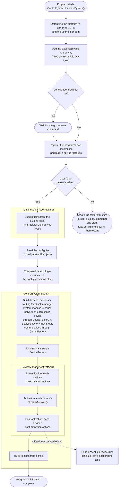

# Essentials Configurable System Lifecycle

The diagram below describes how Essentials gets a program up and running.

The activation phases are covered in more detail on the [next page](~/docs/technical-docs/Arch-activate.md), and plugin loading on the [Plugins](~/docs/technical-docs/Plugins.md) page.

Next: [Activation phases](~/docs/technical-docs/Arch-activate.md)
