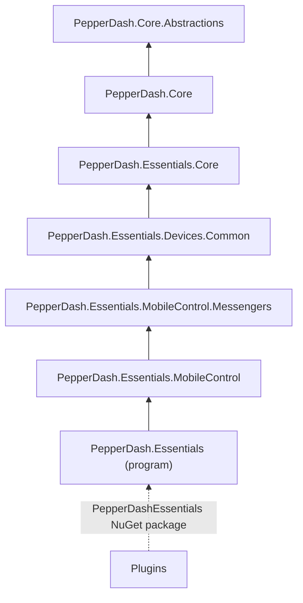

# Essentials architecture

## Summary

PepperDash Essentials is an open-source framework for control systems, built on Crestron's Simpl# Pro framework. Essentials v3 targets .NET 8 and runs on 4-series processors and VC-4 servers. It can be configured as a standalone program capable of running a wide variety of system designs and can also be used to augment other Crestron programs.

Essentials is a collection of C# libraries that can be used in many ways. It is a 100% configuration-driven framework that can be extended to add different workflows and behaviors, either through the addition of new device-types and classes, or via a plug-in mechanism. The framework is a collection of things that are all related and interconnected, but in general do not have strong dependencies on each other.

## Framework Libraries

The table below is a guide to the basic organization of code within the libraries that make up Essentials v3. Each is a project under `src/` in the repository.

| Library | What it contains |
|---|---|
| `PepperDash.Essentials` | The program itself: `ControlSystem`, which starts the system, loads plugins and config, builds devices, rooms and tie lines, and registers the system's console commands |
| `PepperDash.Essentials.Core` | `DeviceManager` and `DeviceFactory`, the config reader and writer, the plugin loader, the comm factory, feedbacks, routing, SIMPL bridging and join maps, Crestron I/O (relays, digital inputs, Versiports, IR), Fusion, system monitoring and the web API used by Essentials Dev Tools |
| `PepperDash.Essentials.Devices.Common` | Device types and interfaces that aren't Crestron hardware: displays, sources, set top boxes, video and audio codecs, cameras, DSPs, lighting, shades and room interfaces |
| `PepperDash.Essentials.MobileControl` | Mobile Control: the system controller, the Direct Server that serves the web UI and its WebSocket, touchpanel controllers and room bridges |
| `PepperDash.Essentials.MobileControl.Messengers` | The messengers that connect device and room interfaces to Mobile Control clients |
| `PepperDash.Core` | The foundation: the `Device` class and `IKeyed`, logging (Serilog), communication clients and servers (TCP, UDP, SSH, HTTP, WebSocket), Portal config merging and JSON-to-SIMPL utilities |
| `PepperDash.Core.Abstractions` | Interfaces over the Crestron console, environment and data store, so core code can be unit tested without a processor |
| Plugins | Your own device and room types, extensions of existing devices, and bridges for them to SIMPL Windows. See [Plugins](~/docs/technical-docs/Plugins.md) |

The diagram below shows the references between the libraries. An arrow points from a library to the next library it references; each library also references every library below that one. All of them use the Crestron SIMPL# SDK packages. Plugins reference Essentials through the `PepperDashEssentials` NuGet package, which contains all of the libraries.

Next: [Architecture](~/docs/technical-docs/Arch-1.md)
